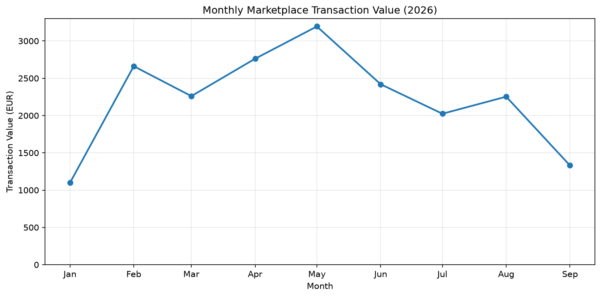

# Second-Hand Marketplace Sales Analysis

# Project Overview

THis project analyzes sales and user activity in a simulated second-hand marketplace using PostgreSQL and Python. 

Goal is to explore marketplace performance, identify sales trends, and understand buyer and seller behaviour.

# Technologies used
* PostreSQL
* Python
* pandas

# Dataset

This project uses synthetic marketplace data generated with Python.

The database contains:
- 100 users
- 6 product categories
- 500 listings
- 250 completed orders

The data is simulated and does not represent actual Vinted transactions.

# Analysis

Using PostgreSQL, I investigated five business questions:

1. Which categories have the most listings?
2. Which categories generate the highest transaction value?
3. What percentage of listings are sold in each category?
4. Who are the top-performing sellers?
5. How does transaction value change over time?

# Key Findings

- **Shoes** generated the highest transaction value (€3,758.60).
- **Accessories** had the highest number of completed sales (48).
- **Jewelry** had the highest sell-through rate (54.17%).
- **May 2026** had the highest monthly transaction value (€3,194.38).

Because of the fact that dataset is randomly generated, results represent the analysis workflow rather than actual marketplace trends .

## Visualisation

The chart shows monthly transaction value in the simulated marketplace. October 2026 contains only partial data, so I would say that it should not be compared directly with complete months.